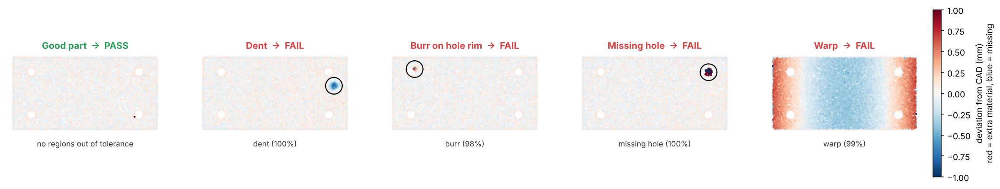
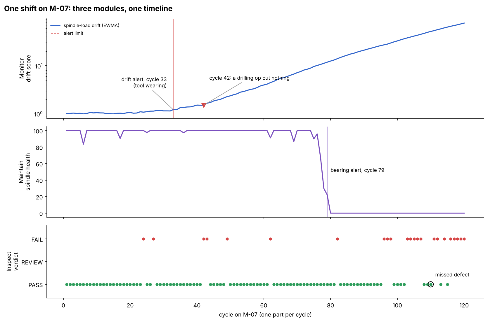

# Speedhacks: Factory AI

**CAD in, inspected parts out.** Job shops that machine custom parts still inspect by hand, because AI inspection needs thousands of labeled defect photos, and a part number that runs 50 times never produces them. This project skips the dataset: it generates labeled training data from the part's CAD, trains the inspection models, and checks every part in seconds. The same edge box also watches the machine that made each part.

> Built at SpeedHacks, Oct 11 2026. Theme: give people their time back.



## The time it saves

| | Manual today | With this |
| --- | --- | --- |
| New part number | Write an inspection plan (~90 min) | Upload CAD, set tolerance, scan 20 good parts (~25 min) |
| Each part | Visual check, calipers, pin gauges, surface plate (~6 min) | Place on fixture (~0.3 min); the scan and verdict take about 0.1 s of compute |
| Flagged parts | Already counted above | Inspector reviews the heat map (~1.5 min each) |
| **Simulated 120-part shift** | **13.5 inspector-hours** | **1.6 inspector-hours (88% saved)** |

Every minute in that table is an **estimate**. They are all set in [`src/factory_ai/timesaved.py`](src/factory_ai/timesaved.py), so you can change any of them. Setup and review time are counted, not only the happy path.

## Demo

```bash
pip install -e ".[dev]"
python demo/run_demo.py          # ~2 min on a laptop CPU; writes out/report.html
python demo/run_demo.py --quick  # ~40 s
pytest                           # 13 tests
```

What the demo does, end to end:

1. **New part number.** BRK-1042 is a 120 × 60 × 8 mm aluminum bracket with four holes and a ±0.25 mm tolerance. All we have is its CAD.
2. **Synthetic data.** The pipeline generates 240 simulated 3D scans from the CAD. It randomizes sensor noise, dropout, view angles and fixture pose, then injects dents, burrs, missing holes and warp. Every point is labeled exactly, with no hand labeling.
3. **Training.** A random-forest classifier learns to classify out-of-tolerance regions. Separately, a "good parts only" anomaly model learns what normal looks like, so it can flag anything unusual.
4. **Calibration.** 20 known-good parts are scanned on the shop's scanner, which is noisier than the one used in training, to re-centre the anomaly model.
5. **A shift on machine M-07.** 120 parts are made. Partway through, the tool wears, a drilling operation cuts nothing once, and a spindle bearing begins to fail. Three modules check every part and every cycle.
6. **Report.** Verdicts, root causes from the data spine, and inspector time saved, all in `out/report.html`.



### Results from the default run (seed 7)

| | |
| --- | --- |
| Defective parts caught (FAIL or REVIEW) | 23 of 24. The one miss is a small burr, shown in the timeline. |
| Good parts wrongly failed | 0 of 96 |
| Skipped drilling op (cycle 42) | Inspect failed the part as `missing_hole`, and Monitor flagged that cycle's "drill 3" operation |
| Tool wear | Monitor's drift alert came at cycle 33. 18 of the 19 burred parts were made after that alert, so a tool change then would have prevented them. |
| Spindle bearing | Maintain alerted at cycle 79 |
| Synthetic holdout | 100% of defect regions classified correctly; 0% of good parts failed |

## What is real and what is simulated

Being honest about this matters more than the numbers above.

- **Real, working code:**
  - scan-to-CAD registration (trimmed point-to-plane ICP)
  - signed deviation maps
  - defect-region clustering and classification
  - the good-parts anomaly model and its calibration
  - spindle-load drift detection (EWMA control chart) and skipped-operation detection
  - bearing-fault detection (envelope analysis at the bearing's outer-race fault frequency, BPFO)
  - the SQLite data spine and its root-cause query
  - the time-saved arithmetic
- **Simulated:**
  - the parts and the 3D scanner
  - the defects
  - the spindle-load traces and accelerometer signals
- **Not yet tested:** real parts or real shop data. The numbers above come from simulation, and real scans of shiny machined metal will be harder.
- **Not built yet:**
  - photorealistic image rendering (BlenderProc or Isaac Sim) for cosmetic defects such as scratches and discoloration, which a geometry check cannot see
  - reading STEP files directly; STL works today
  - live machine connections (OPC UA, MTConnect)

## Repository layout

```
src/factory_ai/
  cad/        parts.py   parametric part catalog (PlatePart), area-weighted surface sampling
              io.py      STL load/write, MeshPart (any customer CAD exported to STL)
  synth/      defects.py dent / burr / missing_hole / warp injection with per-point labels
              scanner.py simulated structured-light scanner + domain randomization
              dataset.py labeled synthetic training sets from CAD
  inspect/    registration.py  trimmed point-to-plane ICP
              deviation.py     signed distance to CAD, out-of-tolerance region clustering
              model.py         defect classifier, good-parts anomaly model, PASS / REVIEW / FAIL
  maintain/   vibration.py     bearing-fault detection, per-machine health baseline
  monitor/    drift.py         spindle-load signatures, EWMA drift, skipped-operation detection
  spine.py    SQLite data spine linking parts, machines and cycles; root-cause query
  timesaved.py inspector-time accounting with explicit assumptions
demo/run_demo.py   end-to-end shift simulation -> out/report.html
tests/             13 tests: registration, defects, model, STL, maintain, monitor, spine
docs/              architecture and roadmap
```

## How it works

```
CAD (STL) ─► sample surface ─► inject defects ─► simulated scans ─► train classifier + anomaly model
                                                                              │
real scan ─► ICP to CAD ─► signed deviation ─► out-of-tolerance regions ─► classify ─► PASS / REVIEW / FAIL
                                                                              │
spindle load ─► drift / skipped op ─┐                                        ▼
vibration    ─► bearing health    ─┴──────────────► data spine (part × machine × cycle) ─► root cause
```

Verdict logic:
- **FAIL:** at least one region is classified as a defect with 60% or higher confidence.
- **REVIEW:** a lower-confidence defect region, or an anomaly score above the calibrated threshold. A person looks at the part.
- **PASS:** otherwise.

See [docs/architecture.md](docs/architecture.md) for the design and the roadmap.
